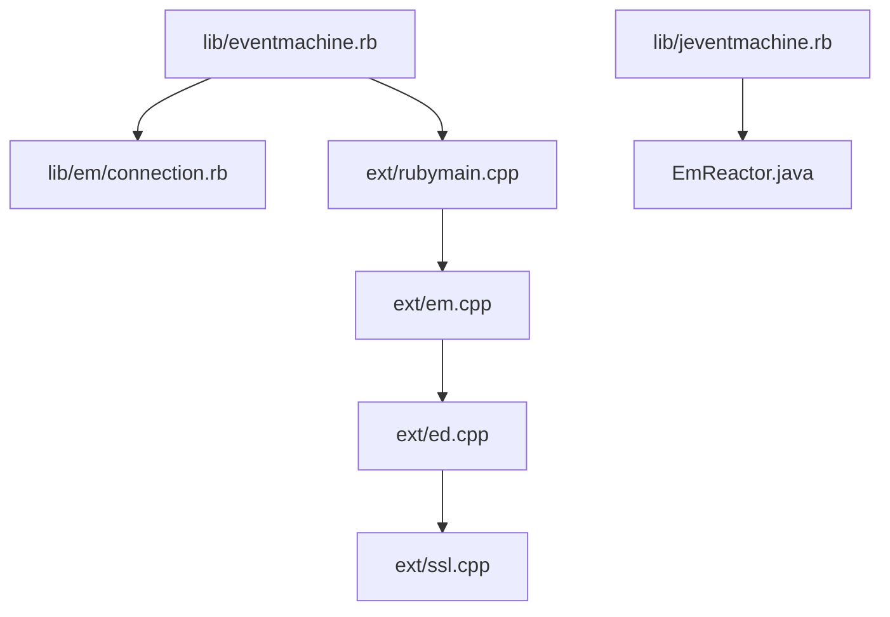

# eventmachine/eventmachine

> Bibliothèque Ruby d'entrées/sorties événementielles pour serveurs et clients réseau concurrents.

## Le problème
Écrire des serveurs réseau concurrents avec des threads est complexe et peu scalable.

## Ce que ça fait vraiment
Elle applique le patron Reactor : l'API Ruby (`lib/eventmachine.rb`) appelle un réacteur en C++ (`em.cpp` pour la boucle, `ed.cpp` pour les descripteurs, `ssl.cpp` pour TLS). Sous JRuby, un réacteur Java (`EmReactor`) prend le relais. On l'utilise pour serveurs, clients asynchrones, proxys et surveillance de fichiers.

## Comment c'est branché
Schéma d'après le diagramme fourni.



## Essayer
```ruby
gem install eventmachine

require 'eventmachine'
EventMachine.run {
  EventMachine.start_server "127.0.0.1", 8081, EchoServer
}
```
Le module `EchoServer` est défini dans le README.

## Coût et pièges
Gratuit. Compilation d'extension C++ lors de l'installation du gem, Ruby requis. La documentation se limite à une référence et un wiki.

## Ce que ce n'est pas
Pas un framework web : un socle bas niveau, que Thin ou Goliath utilisent. 201 issues ouvertes.

## Alternatives
- Celluloid : cité par le README pour qui est insatisfait d'EventMachine.

## Pour toi
À ignorer : Ruby asynchrone, sans lien avec ton travail ; en Python, asyncio fait ce même travail.

