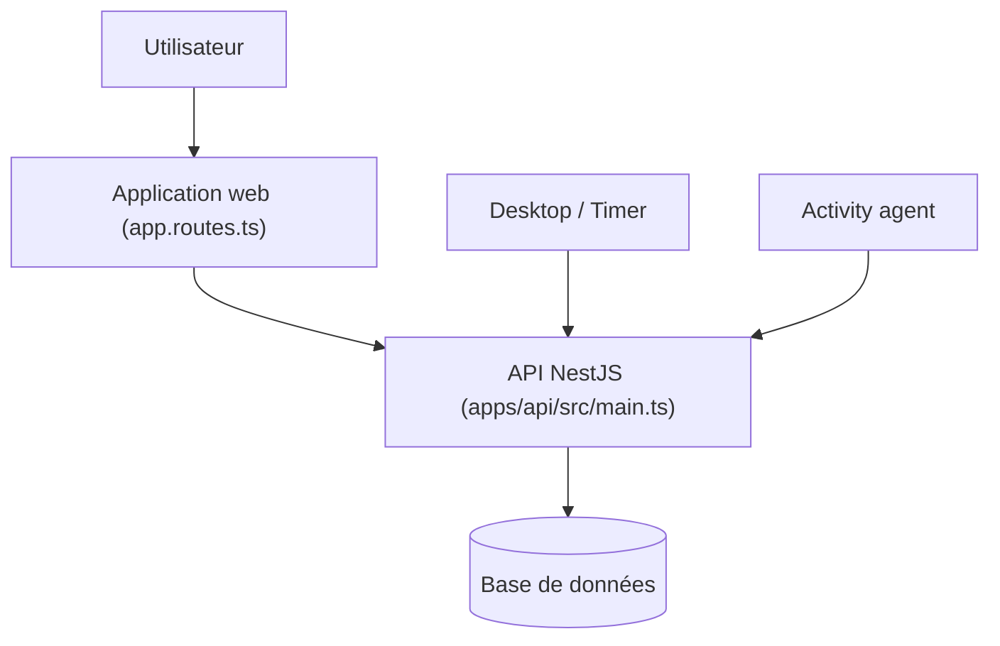

# ever-co/ever-gauzy

> Open source ERP, CRM, HR and time-tracking platform for businesses and freelance teams.

## The problem
Small organizations juggle separate tools for project management, finance, HR and time tracking.

## What it actually does
Angular web application with a NestJS API, covering ERP, CRM, HR, recruiting, projects, sales, invoicing and reports. Desktop applications (server, timer with screenshots). SQLite databases by default, PostgreSQL or MySQL in production. Compose setup with Redis, OpenSearch, MinIO, Jitsu, Cube.

## How it is wired


## Trying it
```bash
docker-compose -f docker-compose.demo.yml up
yarn bootstrap
yarn start
docker compose -f docker-compose.caddy.yml --env-file .env.caddy up -d
```

## Cost and gotchas
In production, set the JWT secrets, the Express session and the three `DEMO_*` passwords: the API refuses to start otherwise. Node 26 or later. The SaaS version is flagged as alpha.

## What it is not
Not a data/AI tool. The demo credentials (`admin`) are only valid for local trials.

## Alternatives
No alternative named in the README.

## For you
Ignore: business management suite outside the data/AI/MLOps scope.
