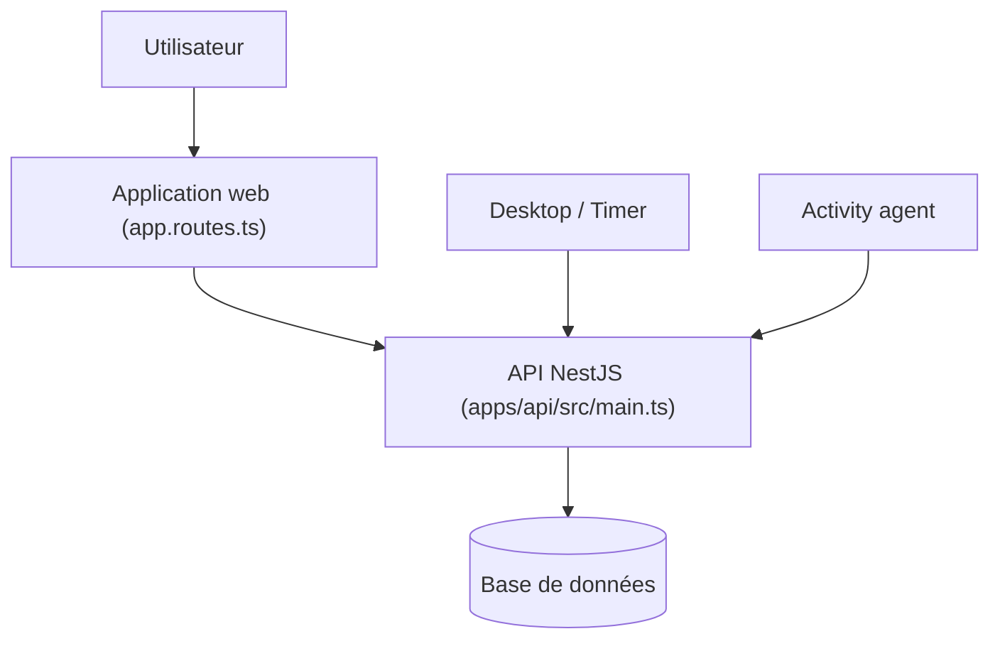

# ever-co/ever-gauzy

> Plateforme open source ERP, CRM, RH et suivi du temps pour entreprises et équipes freelances.

## Le problème
Les petites structures jonglent entre outils séparés pour la gestion de projet, les finances, les RH et le suivi du temps.

## Ce que ça fait vraiment
Application web Angular avec API NestJS, couvrant ERP, CRM, RH, recrutement, projets, ventes, facturation et rapports. Applications bureau (serveur, timer avec captures d'écran). Bases SQLite par défaut, PostgreSQL ou MySQL en production. Compose avec Redis, OpenSearch, MinIO, Jitsu, Cube.

## Comment c'est branché


## Essayer
```bash
docker-compose -f docker-compose.demo.yml up
yarn bootstrap
yarn start
docker compose -f docker-compose.caddy.yml --env-file .env.caddy up -d
```

## Coût et pièges
En production, définir les secrets JWT, la session Express et les trois mots de passe `DEMO_*` : l'API refuse de démarrer sinon. Node 26 ou plus. La version SaaS est signalée en alpha.

## Ce que ce n'est pas
Pas un outil data/IA. Les identifiants de démo (`admin`) ne valent que pour l'essai local.

## Alternatives
Aucune alternative nommée dans le README.

## Pour toi
Ignorer : progiciel de gestion hors périmètre data/IA/MLOps.

