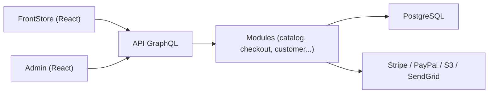

# evershopcommerce/evershop

> E-commerce platform in TypeScript, GraphQL and React, modular and customizable by developers.

## The problem
Setting up a custom online shop requires reassembling catalog, cart, payment and administration.

## What it actually does
A monorepo of modules (catalog, cart, customers, CMS, promotions, taxes, orders) exposed through a unified GraphQL API, with two React clients (storefront and administration) and a PostgreSQL database. Packages plug in PayPal, Stripe, cash on delivery, S3/Azure storage, email sending (Resend, SendGrid) and Google login.

## How it is wired


## Trying it
```bash
curl -sSL https://raw.githubusercontent.com/evershopcommerce/evershop/main/docker-compose.yml > docker-compose.yml
docker compose up -d
```

## Cost and gotchas
Docker required; third-party services (payment, email, storage) have their own accounts and fees. The README announces a future "EverShop Cloud" and is looking for investors.

## What it is not
Not a data/AI tool. The GPL-3.0 imposes copyleft if you redistribute a modified version. A public demo account is given in the README.

## Alternatives
No alternative named in the README.

## For you
Ignore: an online selling platform unrelated to data/AI work, unless you have a specific e-commerce project.
