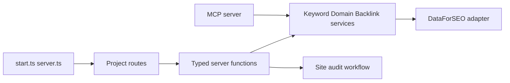

# every-app/open-seo

> Open source alternative to Semrush and Ahrefs, with an MCP server, to self-host with your DataForSEO key.

## The problem
SEO suites are expensive and heavy, when you only use a few workflows and want to hand them to an agent.

## What it actually does
React application with projects: keyword research, rank tracking, competitor and domain analysis, backlinks, site audits, AI visibility and Google Search Console. Data comes from DataForSEO (single adapter). Exposed through an MCP server and agent skills. D1 (Cloudflare) or PostgreSQL database; hosted version at $10/month.

## How it is wired

## Trying it
No command in the README; it points to `docs/SELF_HOSTING_DOCKER.md`, `docs/SELF_HOSTING_CLOUDFLARE.md` and `docs/LOCAL_DEVELOPMENT.md`.

## Cost and gotchas
Pay-as-you-go at DataForSEO (key required). The hosted version adds 28% on each DataForSEO request. The README recommends Cloudflare for hosting open to the Internet; Docker for personal trials.

## What it is not
Not free in real use: the SEO data is billed by a third party. It is not an in-house crawler for all metrics; it depends on the provider.

## Alternatives
Semrush and Ahrefs (compared in the README).

## For you
Keep an eye on it: interesting for plugging SEO data into an agent via MCP, but the DataForSEO cost and the lack of commands in the README weigh before adoption.
