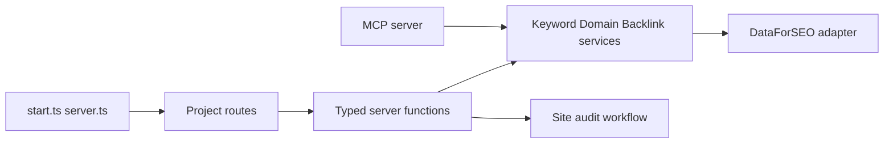

# every-app/open-seo

> Alternative open source à Semrush et Ahrefs, avec serveur MCP, à auto-héberger avec ta clé DataForSEO.

## Le problème
Les suites SEO coûtent cher et sont lourdes, alors qu'on n'utilise que quelques workflows et qu'on veut les confier à un agent.

## Ce que ça fait vraiment
Application React avec projets : recherche de mots-clés, suivi de position, analyse de concurrents et de domaines, backlinks, audits de site, visibilité IA et Google Search Console. Les données viennent de DataForSEO (adaptateur unique). Exposé par un serveur MCP et des skills d'agent. Base D1 (Cloudflare) ou PostgreSQL ; version hébergée à 10 $/mois.

## Comment c'est branché

## Essayer
Aucune commande dans le README ; il renvoie à `docs/SELF_HOSTING_DOCKER.md`, `docs/SELF_HOSTING_CLOUDFLARE.md` et `docs/LOCAL_DEVELOPMENT.md`.

## Coût et pièges
Paiement à l'usage chez DataForSEO (clé obligatoire). La version hébergée ajoute 28 % sur chaque requête DataForSEO. Le README recommande Cloudflare pour un hébergement ouvert sur Internet ; Docker pour essai personnel.

## Ce que ce n'est pas
Pas gratuit en usage réel : les données SEO sont facturées par un tiers. Ce n'est pas un crawler maison pour toutes les métriques ; il dépend du fournisseur.

## Alternatives
Semrush et Ahrefs (comparés dans le README).

## Pour toi
À surveiller : intéressant pour brancher des données SEO à un agent via MCP, mais le coût DataForSEO et l'absence de commandes dans le README pèsent avant adoption.

