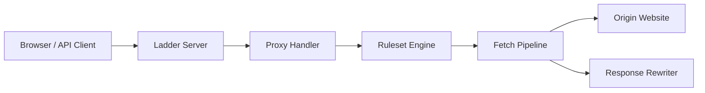

# everywall/ladder

> HTTP proxy in Go for testing how a site serves its content depending on the type of client.

## The problem
Debugging headers, access rules and paywall behavior requires simulating different browsers and bots.

## What it actually does
A Fiber server: an entered URL (form, `/api/…` or `/raw/…`) goes through optional authentication, domain rule matching, request modification, then fetching from the origin site. The response is rewritten (headers, CSP, injected code) and returned as HTML, raw HTML or API data. Rules come from local or remote YAML; FlareSolverr is an optional external component.

## How it is wired


## Trying it
```bash
docker run -p 8080:8080 -d --env RULESET=https://raw.githubusercontent.com/everywall/ladder-rules/main/ruleset.yaml --name ladder ghcr.io/everywall/ladder:latest
curl -X GET "http://localhost:8080/api/https://www.example.com"
```

## Cost and gotchas
Free. If the instance is public, enable Basic Auth (`USERPASS`): otherwise anyone can use it and the host is responsible, the README warns. Windows mode is "untested".

## What it is not
The README frames it as a testing and research tool, to be used in compliance with the laws and the sites' terms of use; it does not bypass advanced anti-automation protections. The FlareSolverr integration is optional and its use is the user's responsibility. GPL-3.0 license.

## Alternatives
No alternative named in the README.

## For you
Ignore: usage centered on accessing third-party site content, legally risky, with no benefit for data/AI/MLOps work.
