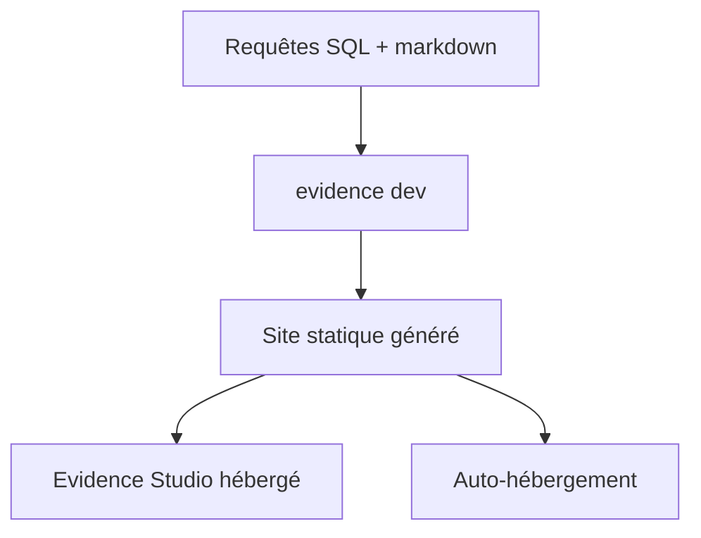

# evidence-dev/evidence

> Open-source tool for building data reports in SQL and markdown, an alternative to drag-and-drop BI.

## The problem
Drag-and-drop BI tools are hard to version, review and automate. Writing a data report as code lacks a ready-made framework.

## What it actually does
Reports written in SQL + markdown. Development through the Evidence agent or locally with Claude Code / Cursor. Self-hosting or publishing on Evidence Studio (generated static site). CLI `evidence init` / `evidence dev`.

## How it is wired


## Trying it
```bash
curl -fsSL https://evidence.studio/install.sh | sh
evidence help
```
```bash
evidence init my-project
cd my-project
evidence dev
```

## Cost and gotchas
Free core; Evidence Studio is the paid hosted offering. Very short README: little detail on the supported data sources.

## What it is not
Not a no-code tool: you have to write SQL. Minimal README, insufficient material to judge the depth.

## Alternatives
Not named in the README.

## For you
Appealing for a data scientist who wants versioned, "as-code" reports rather than a clickable dashboard; to be evaluated hands-on.
