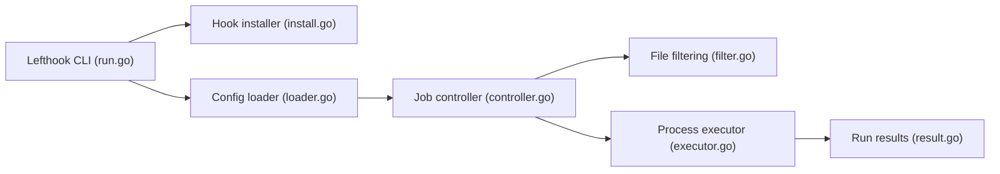

# evilmartians/lefthook

> Git hooks manager in Go, single binary, for Node, Ruby, Python and other projects.

## The problem
Run lint and tests before commit or push, only on the relevant files, without homemade scripts or heavy dependencies.

## What it actually does
Reads `lefthook.yml`, installs the Git hook scripts, then runs jobs with filters (glob, regex, `{staged_files}`), in parallel, per subfolder, by tags, via scripts or Docker. Local config, manual execution of a group (`lefthook run`), adjustable output. The code also shows a hook installer for AI assistants and an automatic update.

## How it is wired


## Trying it
```bash
npm install lefthook --save-dev
vim lefthook.yml
lefthook install
lefthook run pre-commit
```

## Cost and gotchas
Free. Hooks can be bypassed (`--no-verify` on the Git side, not described here). This list of installs (Go 1.26, npm, gem, pipx) shows you pick your own package manager.

## What it is not
Not a lint tool: it orchestrates yours.

## Alternatives
None named in the README.

## For you
Adopt: a single `lefthook.yml` for ruff, fast tests and secret checks in a polyglot MLOps repo.
