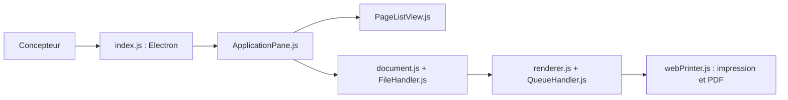

# evolus/pencil

> Desktop UI prototyping and mockup tool, being rewritten on Electron.

## The problem
Drawing interface mockups often requires an online or proprietary tool.

## What it actually does
Mockup application: pages, shapes, shape collections, printing and PDF export. Version 3 migrates from Mozilla XULRunner to Electron, with a zip file format, tree-structured pages, embedded fonts and page handling that reduces memory. The README announces GA builds in June (no year given).

## How it is wired


## Trying it
```bash
git checkout development
npm install
npm start
```

## Cost and gotchas
Free. You need the `development` branch and nodejs 5+; these are old instructions. 533 open issues. GPL-2.0 license.

## What it is not
Not an actively maintained end-to-end tool: the README describes v3 as "under heavy development". The listed platforms are old (OS X 10.9, Ubuntu 12.04).

## Alternatives
- No alternative named in the README.

## For you
Ignore: desktop mockup tool unrelated to data/AI, and its README looks dated.
