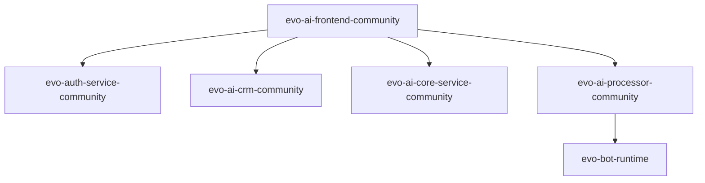

# evolution-foundation/evo-crm-community

> Self-hostable, AI-assisted customer support CRM platform, for small support teams.

## The problem
Managing conversations, contacts and AI support agents means stitching together several authentication, CRM and agent-execution services.

## What it actually does
Parent repository that aggregates six services via submodules: authentication (Rails), CRM (Rails), frontend (React), AI agent processor (Python/FastAPI), agent management (Go) and bot pipeline (Go). The services talk to each other through a Bearer token issued by the authentication service. Current version: v1.0.0-rc2.

## How it is wired


## Trying it
```bash
git clone --recurse-submodules --branch v1.0.0-rc2 git@github.com:evolution-foundation/evo-crm-community.git
git submodule update --init --recursive
docker pull evoapicloud/evo-ai-crm-community:1.0.0-rc2
```

## Cost and gotchas
Six services to configure one by one, each with its own README. The authentication service must be initialized before the CRM. In production, BACKEND_URL and FRONTEND_URL must be public. AI provider keys are your responsibility.

## What it is not
It is not a stable release: it is a release candidate. The super_admin role is not limited to one person, as the README itself says. The repository is only an entry point, not the code of the services.

## Alternatives
No alternative named in the README.

## For you
Keep an eye on it: an interesting multi-agent stack to observe for support, but still a release candidate and heavy to operate.
