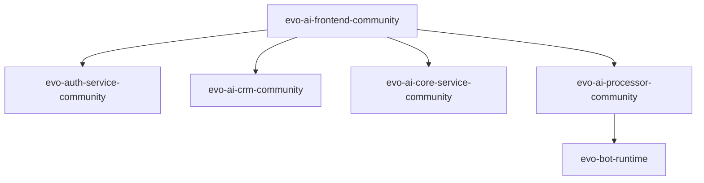

# evolution-foundation/evo-crm-community

> Plateforme CRM de support client assistée par IA, auto-hébergeable, pour petites équipes support.

## Le problème
Gérer conversations, contacts et agents IA de support demande de recoller plusieurs services d'authentification, de CRM et d'exécution d'agents.

## Ce que ça fait vraiment
Dépôt parent qui agrège par sous-modules six services : authentification (Rails), CRM (Rails), frontend (React), processeur d'agents IA (Python/FastAPI), gestion d'agents (Go) et pipeline de bots (Go). Les services se parlent par jeton Bearer émis par le service d'authentification. Version actuelle : v1.0.0-rc2.

## Comment c'est branché


## Essayer
```bash
git clone --recurse-submodules --branch v1.0.0-rc2 git@github.com:evolution-foundation/evo-crm-community.git
git submodule update --init --recursive
docker pull evoapicloud/evo-ai-crm-community:1.0.0-rc2
```

## Coût et pièges
Six services à configurer un par un, chacun avec son README. Le service d'authentification doit être initialisé avant le CRM. En production, BACKEND_URL et FRONTEND_URL doivent être publiques. Les clés de fournisseurs d'IA sont à ta charge.

## Ce que ce n'est pas
Ce n'est pas une version stable : c'est une release candidate. Le rôle super_admin n'est pas limité à une personne, ce que le README dit lui-même. Le dépôt n'est qu'un point d'entrée, pas le code des services.

## Alternatives
Aucune alternative nommée dans le README.

## Pour toi
À surveiller : stack multi-agents intéressante à observer pour du support, mais encore en release candidate et lourde à opérer.

