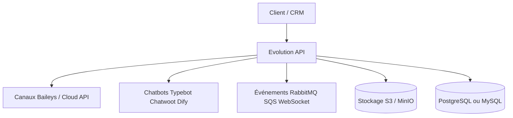

# evolution-foundation/evolution-api

> Multichannel WhatsApp REST API, with chatbot connectors, for those integrating messaging into their systems.

## The problem
Hooking WhatsApp up to a CRM, a bot or an event queue means managing sessions, webhooks and media yourself.

## What it actually does
A Node/TypeScript/Express server exposes WhatsApp via Baileys (unofficial, WhatsApp Web style) or Meta's official Cloud API. It connects to Typebot, Chatwoot, Dify, OpenAI (audio), RabbitMQ, Kafka, SQS, Socket.io and S3/MinIO. Authentication uses an `apikey` key and instance tokens.

## How it is wired


## Trying it
```bash
docker pull evoapicloud/evolution-api:latest
docker run -p 8080:8080 --env-file .env evoapicloud/evolution-api:latest
```

## Cost and gotchas
PostgreSQL/MySQL database required, Redis recommended. The Cloud API may charge per message. Anonymous telemetry (routes, version) is enabled.

## What it is not
Baileys is not the official API: limitations and risk of being blocked are possible according to the README. The license is not identified by GitHub.

## Alternatives
- WhatsApp Cloud API (Meta): the official one, for professional volumes.
- Baileys: the underlying library, if you want fewer layers.

## For you
Worth watching: unrelated to data/AI, useful only for a WhatsApp bot; check the license before any commercial use.
