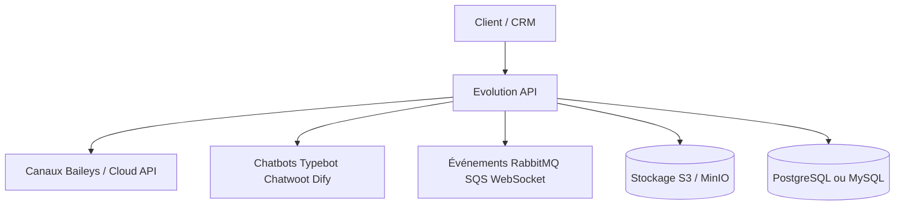

# evolution-foundation/evolution-api

> API REST WhatsApp multicanal, avec connecteurs de chatbots, pour qui intègre la messagerie à ses systèmes.

## Le problème
Brancher WhatsApp à un CRM, un bot ou une file d'événements demande de gérer sessions, webhooks et médias soi-même.

## Ce que ça fait vraiment
Un serveur Node/TypeScript/Express expose WhatsApp via Baileys (non officiel, type WhatsApp Web) ou l'API Cloud officielle de Meta. Il se connecte à Typebot, Chatwoot, Dify, OpenAI (audio), RabbitMQ, Kafka, SQS, Socket.io et S3/MinIO. L'authentification se fait par clé `apikey` et jetons d'instance.

## Comment c'est branché


## Essayer
```bash
docker pull evoapicloud/evolution-api:latest
docker run -p 8080:8080 --env-file .env evoapicloud/evolution-api:latest
```

## Coût et pièges
Base PostgreSQL/MySQL requise, Redis recommandé. L'API Cloud peut facturer par message. Télémétrie anonyme (routes, version) activée.

## Ce que ce n'est pas
Baileys n'est pas l'API officielle : limitations et risque de blocage possibles selon le README. La licence n'est pas identifiée par GitHub.

## Alternatives
- WhatsApp Cloud API (Meta) : l'officiel, pour des volumes pro.
- Baileys : la bibliothèque sous-jacente, si tu veux moins de couches.

## Pour toi
À surveiller : sans lien direct avec la data/IA, utile seulement pour un bot WhatsApp ; vérifier la licence avant tout usage commercial.

