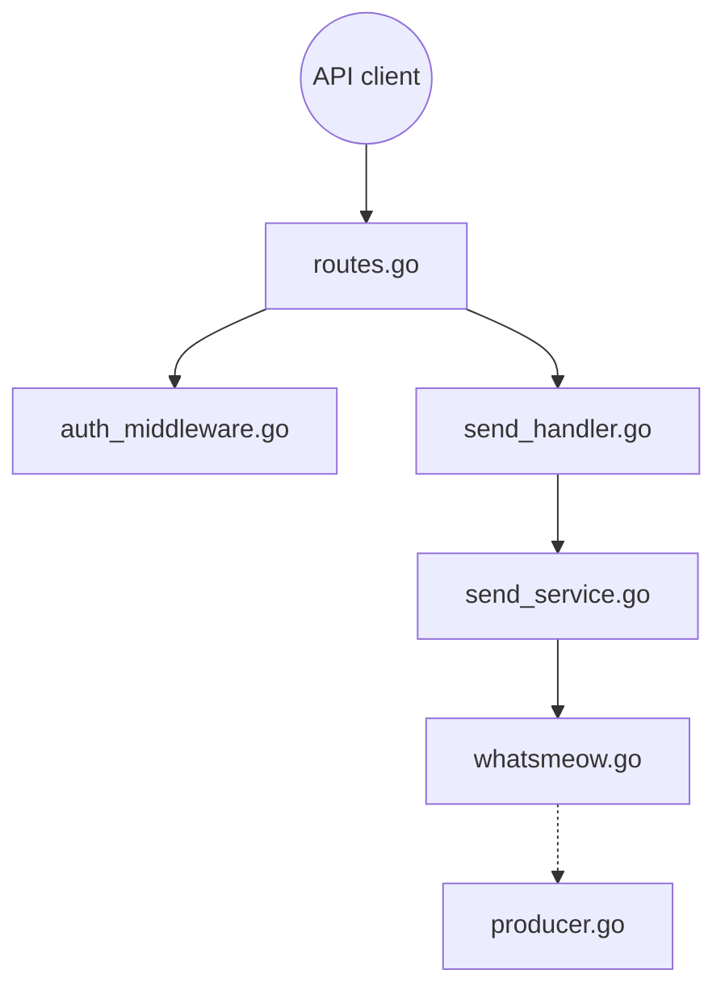

# evolution-foundation/evolution-go

> REST API in Go to drive WhatsApp through the whatsmeow library, for integration developers.

## The problem
Connecting WhatsApp to a CRM or to automations requires a gateway: instances, QR code pairing, message sending, events.

## What it actually does
Gin server: a request goes through authentication (`GLOBAL_API_KEY`), then a handler and a service, which act on a WhatsApp instance (whatsmeow). Endpoints to create an instance, fetch the QR code, send text or media. Events can go out via WebSocket, webhook, RabbitMQ or NATS; media on MinIO/S3; messages in PostgreSQL (optional). A licensing module with a heartbeat starts with the application.

## How it is wired


## Trying it
```bash
git clone https://github.com/evolution-foundation/evolution-go.git
cd evolution-go
make docker-build
make docker-run
```
Swagger: `http://localhost:8080/swagger/index.html`.

## Cost and gotchas
Free; PostgreSQL required, `GLOBAL_API_KEY` mandatory, RabbitMQ, NATS and MinIO optional. Anonymous telemetry (routes, version): the README gives no way to turn it off. 130 open issues.

## What it is not
Not an official WhatsApp client: the README does not discuss WhatsApp's terms of use. The built-in "licensing" (activation, heartbeat) is not explained; the repository's license was not identified.

## Alternatives
- Evolution API (Node.js): sibling project mentioned in the README.

## For you
Ignore: a messaging gateway unrelated to data/AI/MLOps, with an unclear license, telemetry and an opaque licensing module.
