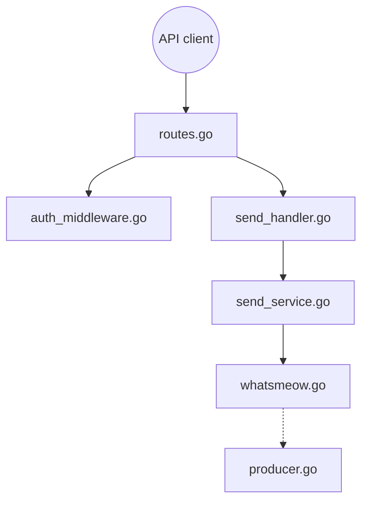

# evolution-foundation/evolution-go

> API REST en Go pour piloter WhatsApp via la bibliothèque whatsmeow, pour développeurs d'intégrations.

## Le problème
Brancher WhatsApp à un CRM ou à des automatisations exige une passerelle : instances, appairage par QR code, envoi de messages, événements.

## Ce que ça fait vraiment
Serveur Gin : une requête passe par l'authentification (`GLOBAL_API_KEY`), puis un handler et un service, qui agissent sur une instance WhatsApp (whatsmeow). Endpoints pour créer une instance, récupérer le QR code, envoyer texte ou média. Événements possibles via WebSocket, webhook, RabbitMQ ou NATS ; médias sur MinIO/S3 ; messages en PostgreSQL (optionnel). Un module de licence avec heartbeat démarre avec l'application.

## Comment c'est branché


## Essayer
```bash
git clone https://github.com/evolution-foundation/evolution-go.git
cd evolution-go
make docker-build
make docker-run
```
Swagger : `http://localhost:8080/swagger/index.html`.

## Coût et pièges
Gratuit ; PostgreSQL requis, `GLOBAL_API_KEY` obligatoire, RabbitMQ, NATS et MinIO en option. Télémétrie anonyme (routes, version) : le README ne donne pas de moyen de la couper. 130 issues ouvertes.

## Ce que ce n'est pas
Pas un client WhatsApp officiel : le README ne parle pas des conditions d'utilisation de WhatsApp. Le « licensing » intégré (activation, heartbeat) n'est pas expliqué ; licence du dépôt non identifiée.

## Alternatives
- Evolution API (Node.js) : projet frère cité dans le README.

## Pour toi
Ignorer : passerelle de messagerie sans lien avec data/IA/MLOps, avec licence floue, télémétrie et module de licence opaque.

