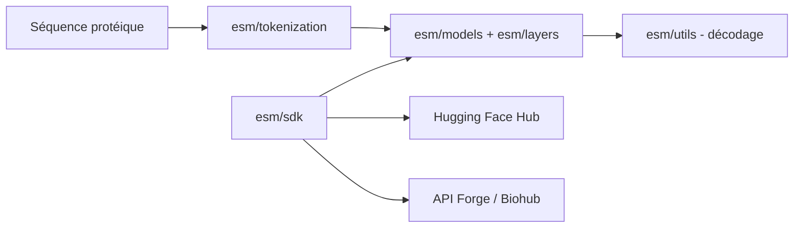

# evolutionaryscale/esm

> Protein language and folding models (ESMC, ESMFold2, SAE) for computational biology researchers.

## The problem
Predicting a protein's structure, or extracting representations from it, requires heavy models that are hard to run yourself.

## What it actually does
The package contains the layers, models and tokenizers of ESMC (language model) and ESMFold2 (all-atom folding, with ligands and DNA). Sparse autoencoders (SAE) on ESMC expose interpretable features. Two routes: Hugging Face weights locally on GPU, or the remote Biohub API (formerly Forge) via a token, with a parallel executor for batches. The README also announces SageMaker support via the SDK.

## How it is wired


## Trying it
```bash
pip install esm
```
Then the README provides Python code: `EsmcForMaskedLM.from_pretrained("biohub/ESMC-6B", device="cuda")` and `EsmFold2Model.from_pretrained("biohub/ESMFold2", device="cuda")`.

## Cost and gotchas
A GPU is required locally (ROCm 6.4 + PyTorch 2.9 mentioned for AMD). Via the API: a token to create on Biohub, safeguards on pathogen sequences. Acceptable use policy to respect.

## What it is not
Not a turnkey tool for non-biologists. The licence is present but not identified by GitHub: read it before any commercial use. Binder design results are only validated in the lab, not by the repository.

## Alternatives
Hugging Face Transformers (ESMC and ESMFold2 are available there, different dependency stack, easier to try).

## For you
Worth watching: very relevant if you do ML on proteins, but heavy on GPU and the licence remains to be checked.
