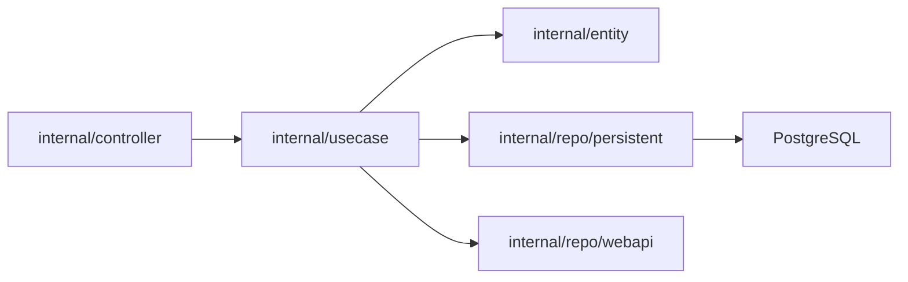

# evrone/go-clean-template

> Go microservice template using Clean Architecture, with REST, gRPC, AMQP and NATS.

## The problem
A growing service quickly turns into spaghetti code without clear rules for how to split it up.

## What it actually does
Three example domains (JWT authentication, tasks, translation) exposed through four transports: REST (Fiber), gRPC, RabbitMQ RPC, NATS RPC. Dependency injection through constructors, Postgres, OpenTelemetry traces sent to Jaeger. Layers `controller`, `usecase`, `entity`, `repo`.

## How it is wired


## Trying it
```bash
make compose-up
make run
make compose-up-integration-test
make compose-up-all
```

## Cost and gotchas
Free; requires Docker, Postgres, RabbitMQ and NATS. Example credentials appear in plain text in the README: change them.

## What it is not
Not a library to import: it is a model to copy and adapt.

## Alternatives
bxcodec/go-clean-arch and zhashkevych/courses-backend, cited in the README.

## For you
Ignore: a general-purpose Go backend template, little related to data/AI/MLOps.
