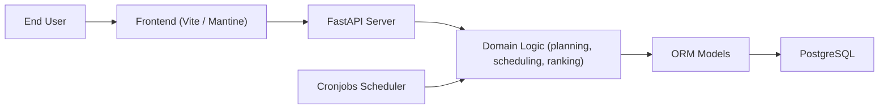

# evroon/bracket

> Self-hosted web application for organizing tournaments (elimination, round-robin, Swiss).

## The problem
Organizing a tournament with several stages, courts and teams calls for a scheduling tool, not a spreadsheet.

## What it actually does
Asynchronous FastAPI backend with PostgreSQL, Vite/Mantine frontend (the diagram mentions Next.js). Handles single elimination, round-robin and Swiss (automatic scheduling), multiple stages, drag-and-drop of matches onto courts, teams, clubs, and public dashboards with a logo. Scheduled tasks (planning, deletion of demo data).

## How it is wired


## Trying it
```bash
git clone git@github.com:evroon/bracket.git
cd bracket
sudo docker compose up -d
docker exec bracket-backend uv run --no-dev ./cli.py create-dev-db
```

## Cost and gotchas
Free; Docker Compose starts the backend, frontend and Postgres. The README displays a demo login with a password: change it before exposing anything.

## What it is not
Not a data or AI tool. AGPL-3.0 license: obligations apply if you host it for third parties.

## Alternatives
No alternative named in the README.

## For you
Ignore for a data/AI profile: unrelated to your work, even though it looks clean and easy to launch.
