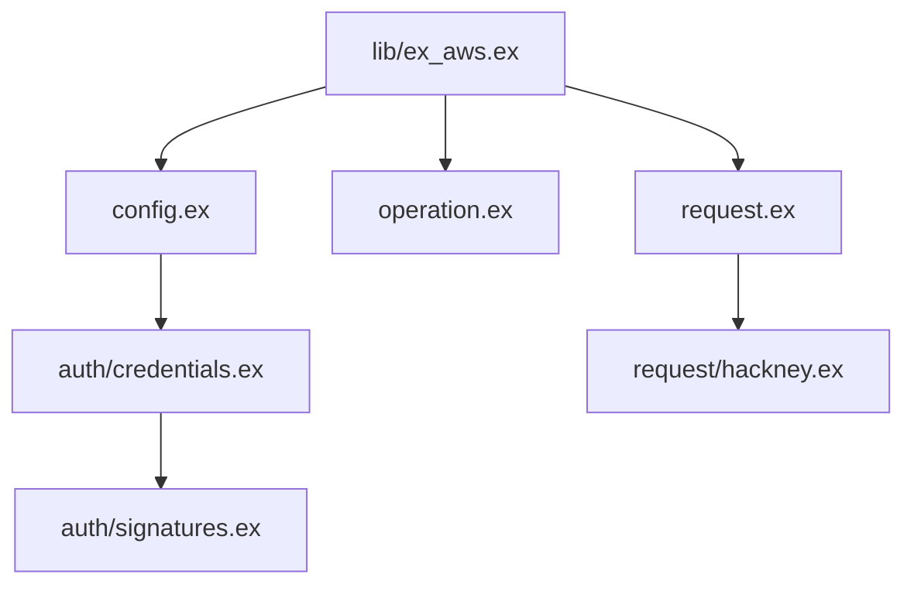

# ex-aws/ex_aws

> Set of AWS APIs for Elixir, one package per service, on top of a swappable HTTP client.

## The problem
Calling AWS APIs from Elixir requires signing requests and handling credentials, pagination and retries.

## What it actually does
`ExAws.request` reads the configuration, resolves credentials (environment variables, EKS Pod Identity, instance role, AWS CLI profile), signs the operation and sends it via Hackney or Req. Each service has its own package (`ex_aws_s3`, etc.). Retries with exponential backoff and Elixir streams for pagination. Direct use is possible for a service without a module.

## How it is wired


## Trying it
```elixir
{:ex_aws, "~> 2.1"},
{:ex_aws_s3, "~> 2.0"},
{:hackney, "~> 1.9"},
{:sweet_xml, "~> 0.6"},

ExAws.S3.list_objects("my-bucket") |> ExAws.request()
```

## Cost and gotchas
Free, but AWS calls are billed to you and require valid credentials. Elixir required. Local tests require local DynamoDB via Docker.

## What it is not
Not an official AWS SDK, and each service needs its own package. It does not hide the APIs: it wraps them.

## Alternatives
No alternative named in the README.

## For you
Ignore: only useful if your stack is Elixir; in Python, boto3 covers the need (outside the README).
