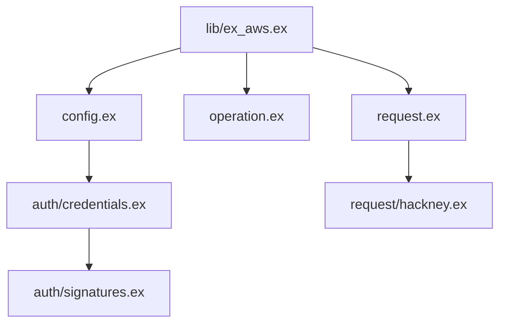

# ex-aws/ex_aws

> Ensemble d'API AWS pour Elixir, un paquet par service, au-dessus d'un client HTTP interchangeable.

## Le problème
Appeler les API AWS depuis Elixir demande de signer les requêtes, gérer les identifiants, la pagination et les nouvelles tentatives.

## Ce que ça fait vraiment
`ExAws.request` lit la configuration, résout les identifiants (variables d'environnement, EKS Pod Identity, rôle d'instance, profil AWS CLI), signe l'opération et l'envoie via Hackney ou Req. Chaque service a son paquet (`ex_aws_s3`, etc.). Reprises avec backoff exponentiel et flux Elixir pour la pagination. Usage direct possible pour un service sans module.

## Comment c'est branché


## Essayer
```elixir
{:ex_aws, "~> 2.1"},
{:ex_aws_s3, "~> 2.0"},
{:hackney, "~> 1.9"},
{:sweet_xml, "~> 0.6"},

ExAws.S3.list_objects("my-bucket") |> ExAws.request()
```

## Coût et pièges
Gratuit, mais les appels AWS sont facturés à ta charge et exigent des identifiants valides. Elixir requis. Les tests locaux demandent DynamoDB local via Docker.

## Ce que ce n'est pas
Pas un SDK officiel AWS, et chaque service demande son paquet. Il ne masque pas les API : il les enveloppe.

## Alternatives
Aucune alternative nommée dans le README.

## Pour toi
Ignorer : utile seulement si ta pile est en Elixir ; en Python, boto3 couvre le besoin (hors README).

