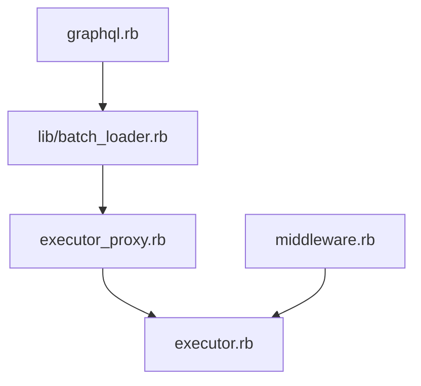

# exAspArk/batch-loader

> Ruby gem that lazily batches requests to avoid N+1 queries against a database or over HTTP.

## The problem
Loading a relation for each object in a list fires one query per object.

## What it actually does
`BatchLoader.for(key).batch` collects the keys, runs a single grouped query on first read, then caches the result. It works with Rails, REST APIs (with the parallel gem) and GraphQL (`BatchLoader::GraphQL`). No dependencies, thread-safe. A middleware clears the cache between requests.

## How it is wired


## Trying it
```bash
gem install batch-loader
```
```ruby
BatchLoader.for(post.user_id).batch do |user_ids, loader|
  User.where(id: user_ids).each { |user| loader.call(user.id, user) }
end
```

## Cost and gotchas
Free. Remember to clear the cache between requests with the middleware. Method replacement can be slow on large objects.

## What it is not
Not an ORM nor a distributed cache. Ruby only.

## Alternatives
shopify/graphql-batch and sheerun/dataloader, cited in the README: more tied to GraphQL and promises.

## For you
Ignore: a problem for Ruby applications, outside the data / AI / MLOps scope.
