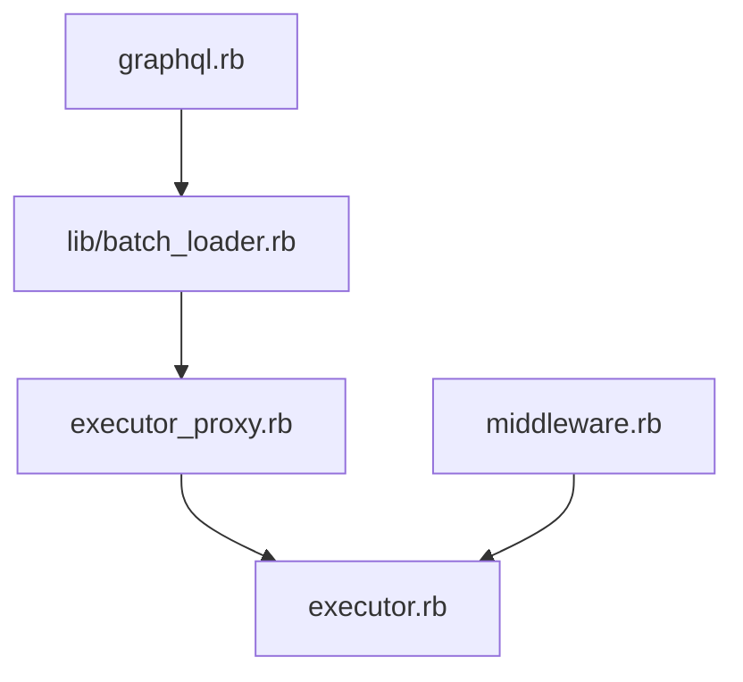

# exAspArk/batch-loader

> Gem Ruby qui regroupe paresseusement les requêtes pour éviter les requêtes N+1 en base ou en HTTP.

## Le problème
Charger une relation pour chaque objet d'une liste lance une requête par objet.

## Ce que ça fait vraiment
`BatchLoader.for(clé).batch` collecte les clés, exécute une seule requête groupée à la première lecture, puis met le résultat en cache. Il fonctionne avec Rails, des API REST (avec la gem parallel) et GraphQL (`BatchLoader::GraphQL`). Sans dépendance, sûr pour les threads. Un middleware vide le cache entre requêtes.

## Comment c'est branché


## Essayer
```bash
gem install batch-loader
```
```ruby
BatchLoader.for(post.user_id).batch do |user_ids, loader|
  User.where(id: user_ids).each { |user| loader.call(user.id, user) }
end
```

## Coût et pièges
Gratuit. Penser à vider le cache entre requêtes avec le middleware. Le remplacement de méthodes peut être lent sur de gros objets.

## Ce que ce n'est pas
Pas un ORM ni un cache distribué. Ruby uniquement.

## Alternatives
shopify/graphql-batch et sheerun/dataloader, cités dans le README : plus liés à GraphQL et aux promesses.

## Pour toi
Ignorer : problème d'applications Ruby, hors périmètre data / IA / MLOps.

