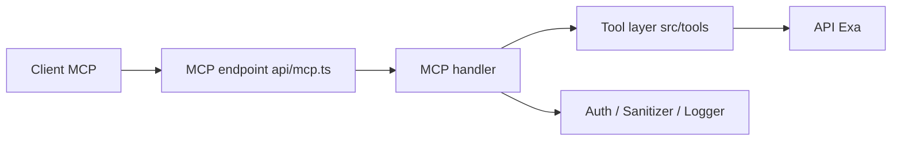

# exa-labs/exa-mcp-server

> MCP server giving AI agents web search and page reading through the Exa API.

## The problem
Agents need clean, readable web results without writing their own search gateway.

## What it actually does
A hosted MCP server (`https://mcp.exa.ai/mcp`) exposes `web_search_exa` and `web_fetch_exa` by default, plus `web_search_advanced_exa` and `agent_run` as options. The repository also serves as an agent plugin and contains skills (`search`, `exa-agent`). According to the code: Vercel functions, OAuth endpoints and search tools for code, companies and people.

## How it is wired


## Trying it
```bash
claude plugin install exa@claude-plugins-official
codex mcp add exa --url https://mcp.exa.ai/mcp
```

## Cost and gotchas
Anonymous with rate limits; API key or OAuth for more quota and for Exa Agent. The service is hosted by Exa: requests are sent to a third party.

## What it is not
Not a standalone search engine: the repository is a connector to a paid service; the skills are documentation, not runtime code.

## Alternatives
The README names no alternative.

## For you
Worth watching: quick way to connect web search to your agents, but it means depending on a SaaS and its quotas.
