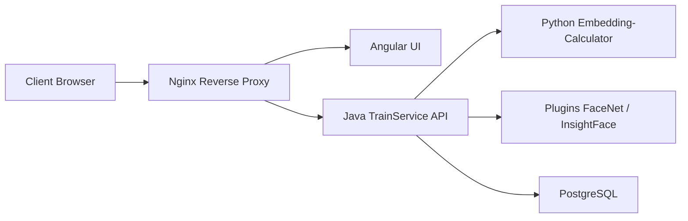

# exadel-inc/CompreFace

> Free face recognition service as a REST API, deployed with Docker, without machine learning expertise.

## The problem
Integrating face recognition into an application normally requires mastering models and managing their deployment.

## What it actually does
REST API for face detection, recognition, verification, landmarks, mask, head pose, age and gender. Relies on FaceNet and InsightFace, runs on CPU or GPU, with role management in a UI. Architecture: Angular UI, Spring Boot services (Admin and TrainService), Flask embedding-calculation service, model plugins, PostgreSQL.

## How it is wired


## Trying it
```bash
docker-compose up -d
# puis ouvrir http://localhost:8000/login
```
Before that, download and unzip the archive of the latest release.

## Cost and gotchas
Free. Docker and an x86 processor with AVX are required (`lscpu | grep avx`). Last push in October 2024, so the project is not very active.

## What it is not
Not an end-to-end trainable model: it is an inference service. The legal issues of face recognition are not addressed.

## Alternatives
- No alternative named in the README.

## For you
Worth watching: handy for a self-hosted vision prototype, but the absence of commits for over a year weighs on any lasting adoption.
