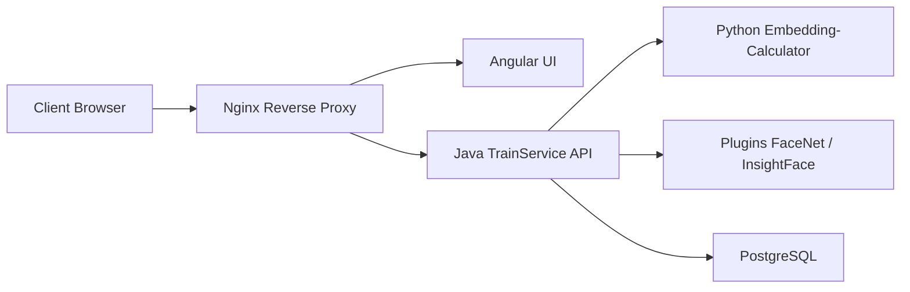

# exadel-inc/CompreFace

> Service libre de reconnaissance faciale en API REST, déployé avec Docker, sans expertise en machine learning.

## Le problème
Intégrer de la reconnaissance faciale dans une application oblige normalement à maîtriser des modèles et à gérer leur déploiement.

## Ce que ça fait vraiment
API REST pour détection, reconnaissance, vérification de visages, points de repère, masque, pose de tête, âge et sexe. S'appuie sur FaceNet et InsightFace, fonctionne sur CPU ou GPU, avec gestion des rôles dans une interface. L'architecture : interface Angular, services Spring Boot (Admin et TrainService), service Flask de calcul d'embeddings, plugins de modèles, PostgreSQL.

## Comment c'est branché


## Essayer
```bash
docker-compose up -d
# puis ouvrir http://localhost:8000/login
```
Avant cela, télécharger et décompresser l'archive de la dernière release.

## Coût et pièges
Gratuit. Docker et un processeur x86 avec AVX sont requis (`lscpu | grep avx`). Dernier push en octobre 2024, donc projet peu actif.

## Ce que ce n'est pas
Pas un modèle entraînable de bout en bout : c'est un service d'inférence. Les enjeux légaux de la reconnaissance faciale ne sont pas traités.

## Alternatives
- Aucune alternative nommée dans le README.

## Pour toi
À surveiller : pratique pour un prototype de vision auto-hébergé, mais l'absence de commits depuis plus d'un an pèse sur toute adoption durable.

