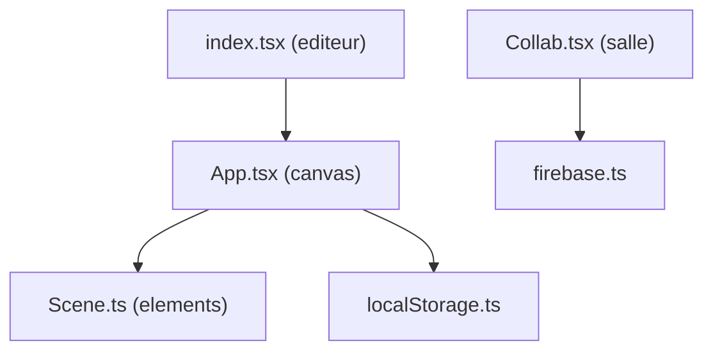

# excalidraw/excalidraw

> Open-source whiteboard with a hand-drawn style, collaborative, and end-to-end encrypted.

## The problem
Quickly create a basic architecture diagram or wireframe, without using heavy-duty tools, and then share or integrate it into another application.

## What it actually does
A canvas editor (npm package `@excalidraw/excalidraw`) with shapes, linked arrows, images, shape libraries, undo/redo, PNG/SVG/paper export, and `.excalidraw` to JSON format. The excalidraw.com app, in the same repository, adds offline PWA (Progressive Web App), real-time collaboration, local saving, and shareable links.

## How it is wired


## Trying it
```bash
npm install react react-dom @excalidraw/excalidraw
# ou
yarn add react react-dom @excalidraw/excalidraw
```

## Cost and gotchas
Free. The integration assumes the use of a React application. File storage for shared files is handled through Firebase within the hosted application; the README does not describe self-hosting.

## What it is not
This is not a formal diagramming tool (such as UML or a data schema). The README states that collaboration and encryption will be added to the npm package "in the future": the npm editor does not currently include these features.

## Alternatives
No alternative is specified in the README file.

## For you
Recommended: for creating diagrams of ML pipelines and architectures to share or incorporate into documentation; a mature and widely used approach.
