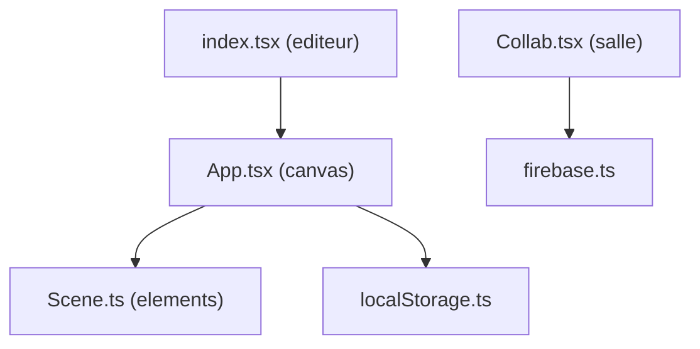

# excalidraw/excalidraw

> Tableau blanc open source au style dessiné à la main, collaboratif et chiffré de bout en bout.

## Le problème
Faire un schéma d'architecture ou un wireframe vite, sans outil lourd, et le partager ou l'intégrer dans une autre appli.

## Ce que ça fait vraiment
Un éditeur canvas (paquet npm `@excalidraw/excalidraw`) avec formes, flèches liées, images, bibliothèques de formes, undo/redo, export PNG/SVG/presse-papiers et format `.excalidraw` en JSON. L'app excalidraw.com, dans le même dépôt, ajoute PWA hors ligne, collaboration temps réel, sauvegarde locale et liens partageables.

## Comment c'est branché


## Essayer
```bash
npm install react react-dom @excalidraw/excalidraw
# ou
yarn add react react-dom @excalidraw/excalidraw
```

## Coût et pièges
Gratuit. L'intégration suppose une appli React. Le stockage des fichiers partagés passe par Firebase dans l'app hébergée ; le README ne décrit pas l'auto-hébergement.

## Ce que ce n'est pas
Pas un outil de diagramme formel (UML, schéma de données). Le README dit que collaboration et chiffrement seront ajoutés au paquet npm « à l'avenir » : l'éditeur npm ne les contient pas encore.

## Alternatives
Aucune alternative nommée dans le README.

## Pour toi
À adopter : pour dessiner des schémas de pipelines ML et d'architecture à partager ou à embarquer dans une doc, mature et très répandu.

