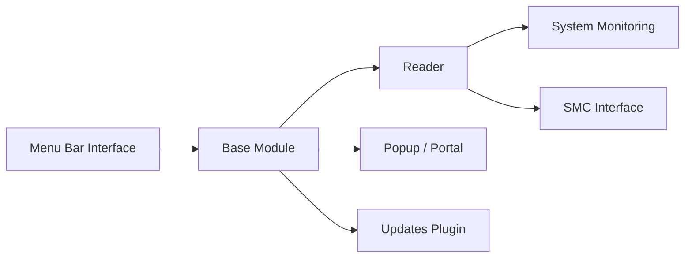

# exelban/stats

> System monitor in the macOS 12+ menu bar, for Mac users.

## The problem
Monitoring CPU, memory or network on a Mac means opening Activity Monitor every time.

## What it actually does
Menu bar modules: CPU, GPU, memory, disk, network, battery, sensors (temperature, voltage, power), Bluetooth, multi-timezone clock, and fan control (no longer maintained). Each module has its reader, its settings, its notification and its popup. The README says it collects no telemetry; the only external requests are for updates and the public IP.

## How it is wired


## Trying it
```bash
brew install stats
sh /Applications/Stats.app/Contents/Resources/Scripts/uninstall.sh
```

## Cost and gotchas
Free. The Sensors and Bluetooth modules consume the most. On macOS 26, you must allow Stats in Settings > Menu Bar. A privileged SMC helper is installed (removed by the uninstall script).

## What it is not
Not a server monitoring or alerting tool. The project is open to read but not to contribute: unsolicited pull requests are declined.

## Alternatives
- No alternative named in the README.

## For you
Adopt if you work on a Mac: it shows GPU load, memory and temperatures during local training, with no declared telemetry, but depends on a single person.
