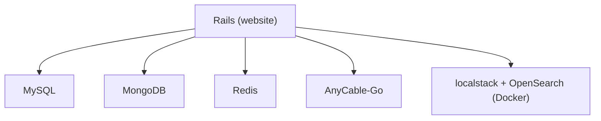

# exercism/website

> Code of the Exercism site, an internal Rails application, published without support for local execution.

## The problem
Exercism is a programming exercise platform with mentoring; this repository is its website.

## What it actually does
Ruby on Rails application backed by MySQL, MongoDB, Redis, AnyCable-Go, and a local AWS simulated by localstack and OpenSearch via Docker. A Procfile launches the services with hivemind or overmind.

## How it is wired
Simplified diagram based on the sheet, no diagram provided.


## Trying it
```bash
bundle install
EXERCISM_ENV=development bundle exec setup_exercism_config
EXERCISM_ENV=development bundle exec setup_exercism_local_aws
overmind start --port 3020 --procfile Procfile.dev
```

## Cost and gotchas
Ruby 3.3.0, MySQL, MongoDB, Redis, AnyCable-Go and Docker: a heavy stack. The team guarantees nothing locally and rejects pull requests. AGPL-3.0.

## What it is not
Not a product to fork or reuse: the README advises against it.

## Alternatives
None named in the README.

## For you
Ignore: an internal repository not meant to be reused; at best a read-through of a Rails architecture.
