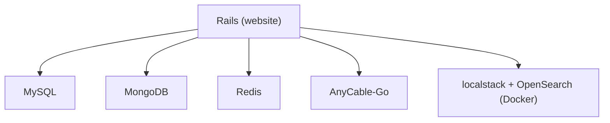

# exercism/website

> Code du site Exercism, application Rails interne, publié sans support pour l'exécution locale.

## Le problème
Exercism est une plateforme d'exercices de programmation avec mentorat ; ce dépôt en est le site web.

## Ce que ça fait vraiment
Application Ruby on Rails adossée à MySQL, MongoDB, Redis, AnyCable-Go, et à un AWS local simulé par localstack et OpenSearch via Docker. Un Procfile lance les services avec hivemind ou overmind.

## Comment c'est branché
Schéma simplifié d'après la fiche, sans diagramme fourni.


## Essayer
```bash
bundle install
EXERCISM_ENV=development bundle exec setup_exercism_config
EXERCISM_ENV=development bundle exec setup_exercism_local_aws
overmind start --port 3020 --procfile Procfile.dev
```

## Coût et pièges
Ruby 3.3.0, MySQL, MongoDB, Redis, AnyCable-Go et Docker : pile lourde. L'équipe ne garantit rien en local et refuse les pull requests. AGPL-3.0.

## Ce que ce n'est pas
Pas un produit à forker ou réutiliser : le README le déconseille.

## Alternatives
Aucune nommée dans le README.

## Pour toi
À ignorer : dépôt interne non prévu pour être réutilisé ; au mieux une lecture d'architecture Rails.

