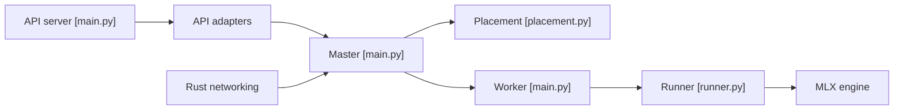

# exo-explore/exo

> Links several devices into a cluster to run large AI models locally, mainly on Mac.

## The problem
A model with several hundred billion parameters doesn't fit in the memory of a single machine.

## What it actually does
Devices discover each other automatically. A master computes the placement according to the topology (memory, latency, bandwidth) and the workers run inference with MLX, using pipeline or tensor parallelism. APIs compatible with OpenAI Chat Completions, Claude Messages, OpenAI Responses and Ollama, plus a dashboard. Linux: CPU only for now.

## How it is wired


## Trying it
```bash
nix run .#exo
git clone https://github.com/exo-explore/exo
cd exo/dashboard && npm install && npm run build && cd ..
uv sync --extra mlx
uv run exo
brew install --cask exo
```
Dashboard and API at http://localhost:52415.

## Cost and gotchas
Heavy prerequisites: Xcode, Rust nightly, Node, uv, macmon. RDMA requires macOS 26.2, Thunderbolt 5, a compatible cable and activation in Recovery mode. macOS versions must be identical everywhere. The announced gains (1.8× on 2 devices, 3.2× on 4) are those of the README.

## What it is not
It is not a hosted service nor a multi-GPU Linux server. The displayed benchmarks come from a third-party source.

## Alternatives
- Ollama (compatible API, cited): simpler on a single machine.

## For you
Worth watching: relevant if you have several recent Macs to test large LLMs locally, otherwise Linux support remains limited to CPU.
