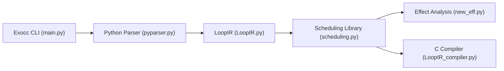

# exo-lang/exo

> Python compiler that schedules tensor loops and generates C for hardware accelerators.

## The problem
Hand-writing optimized kernels for each accelerator is slow and fragile; optimizations are mixed in with the algorithm.

## What it actually does
You write a procedure in Python, transform it with scheduling operations (scheduling API, cursors), then `exocc` generates a C file and a header. Effect and range analyses, memory models, Gemmini, NEON and x86 platforms. Two papers (PLDI 2022, ASPLOS 2025) describe the design.

## How it is wired


## Trying it
```bash
pip install exo-lang
python exo_file.py
exocc exo_file.py
pytest
```

## Cost and gotchas
Free. Python 3.9+; PySMT and a solver (z3 provided) can cause trouble; tests: CMake 3.21+, optional SDE for AMX/AVX-512. 130 open issues.

## What it is not
Not a deep learning framework: it is a kernel compiler for those who know how to schedule loops.

## Alternatives
No alternative named in the README.

## For you
Worth watching: relevant if you write kernels for accelerators, of no use for everyday data science.
