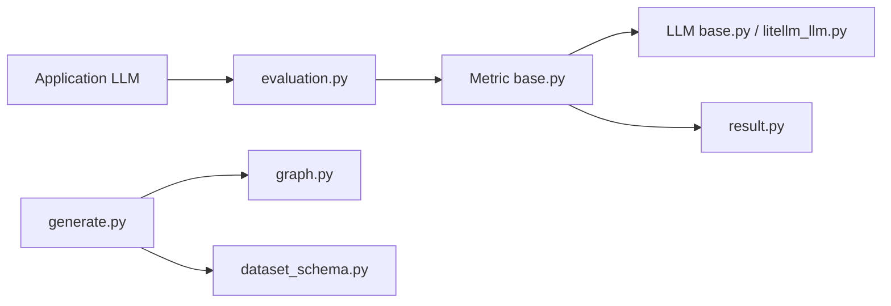

# explodinggradients/ragas

> Python library that scores the quality of LLM applications (RAG mostly) and generates test sets.

## The problem
Evaluating an LLM application by hand is slow and subjective; without a test set, there is nothing to compare from one version to the next.

## What it actually does
Provides metrics (LLM-based or classic) such as `DiscreteMetric`, which call a judge LLM to score an answer. Generates a test set from a knowledge graph and question synthesizers. Offers integrations (LangChain, observability) and a "production feedback" mode. A `rag_eval` template is created by `ragas quickstart`.

## How it is wired


## Trying it
```bash
pip install ragas
ragas quickstart
ragas quickstart rag_eval -o ./my-project
```

## Cost and gotchas
Each score calls an LLM: an API key (the README assumes `OPENAI_API_KEY`) and the bill is on you. Anonymized usage collection, which can be disabled via `RAGAS_DO_NOT_TRACK=true`.

## What it is not
Not an observability platform. The `agent_evals`, `benchmark_llm`, `prompt_evals`, `workflow_eval` templates are "coming soon". The score depends on the chosen judge LLM. 619 open issues.

## Alternatives
No alternative named in the README.

## For you
Adopt it to measure a RAG reproducibly: Apache-2.0, last push February 2026, but budget for the judge LLM's cost and turn off the telemetry.
