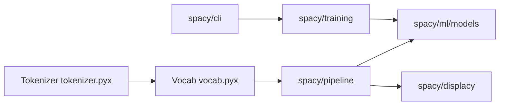

# explosion/spaCy

> Python/Cython natural language processing library, with pretrained pipelines, built for production.

## The problem
Tokenizing, tagging, parsing and extracting entities at large volumes requires components that are fast, consistent and trainable.

## What it actually does
Tokenization for 70+ languages, trained pipelines: POS, dependencies, NER, classification, lemmatization, entity linking.
File-configured training system, transformers (BERT), custom PyTorch/TensorFlow models.
Models distributed as Python packages; syntax/NER visualizers; LLM integration in pipelines.
Maintained by Explosion (a company), MIT.

## How it is wired
Diagram not provided (no readable component). Based on the described architecture:


## Trying it
```bash
pip install -U pip setuptools wheel
pip install spacy
python -m spacy download en_core_web_sm
python -m spacy validate
```

## Cost and gotchas
Free. Python 3.7 to 3.12 (64-bit); building from source is tricky (compiler). Retrain your models after an update.

## What it is not
Not an LLM or a chatbot. No individual support by email. Building from source is not the normal path.

## Alternatives
No alternative named in the README.

## For you
The standard for classic production NLP: worth having in the toolbox.
