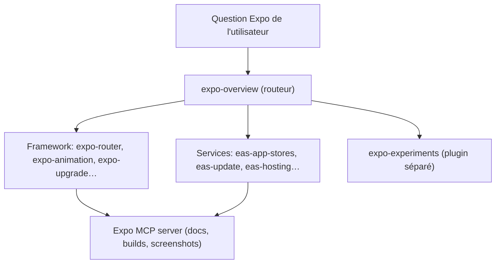

# expo/skills

> The Expo team's official skills for coding agents working on Expo apps.

## The problem
A coding agent that does not know the constraints of Expo, EAS, React Native, iOS and
Android produces plausible but wrong code.

## What it actually does
Provides a collection of `SKILL.md` files grouped into three families. "Framework" (open source,
free) covers project structure, Expo Router, Reanimated animations, native UI,
design systems, data fetching, native modules, brownfield, SDK upgrades.
"Services & paid distribution" covers the paid EAS building blocks: builds and store submission,
hosting, CI/CD workflows, EAS Update and its metrics, remote simulator.
"Experimental" contains the unstable APIs, in a separate `expo-experiments` plugin.
An `expo-overview` skill serves as the entry point to route to the others.

## How it is wired


## Trying it
```bash
npx skills@latest add expo/skills --skill '*'
claude plugin install expo@claude-plugins-official
codex plugin add expo@openai-curated
npx skills@latest update
npx skills@latest update expo-router
```

## Cost and gotchas
The "Framework" skills are free; those in the Services group drive EAS, which
is paid — each skill in this group opens with a note on costs and plan limits.
Usage telemetry is **disabled by default**; it can be enabled (Claude Code only) via
`EXPO_SKILLS_TELEMETRY=1`, turned off by `DO_NOT_TRACK=1`, and is never sent in CI.

## What it is not
It is not documentation: the README says explicitly that the source of truth remains
the Expo docs, the Expo CLI and the EAS CLI. Nor is it an MCP server — that one is a
separate project, simply packaged with the plugin.

## Alternatives
- The Expo MCP server on its own, if you want live access to docs and builds without the skills.

## For you
Irrelevant outside Expo mobile development; ignore for a data / MLOps profile.
