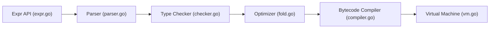

# expr-lang/expr

> Statically typed expression language for Go, which safely evaluates dynamic rules.

## The problem
Letting users write rules (permissions, filters, policies) without executing arbitrary code or freezing those rules into the binary.

## What it actually does
Compiles an expression (parser, type checking, optimization) into bytecode run by a VM, over a supplied Go environment. Advertised as side-effect free, guaranteed to terminate and memory-safe. Built-in functions (`all`, `filter`, `map`…), debugger, REPL, type documentation generation. Used by Argo, OpenTelemetry Collector, CrowdSec, CoreDNS and others (README list).

## How it is wired


## Trying it
```bash
go get github.com/expr-lang/expr
```
```go
program, err := expr.Compile(`sprintf(greet, names[0])`, expr.Env(env))
output, err := expr.Run(program, env)
```

## Cost and gotchas
Free. The security guarantees are claimed by the README; validate them before exposing to hostile inputs.

## What it is not
Not a general-purpose language: no free loops, no side effects.

## Alternatives
None named in the README.

## For you
Worth watching: useful for configurable routing or filtering rules in Go; of no interest in Python.
