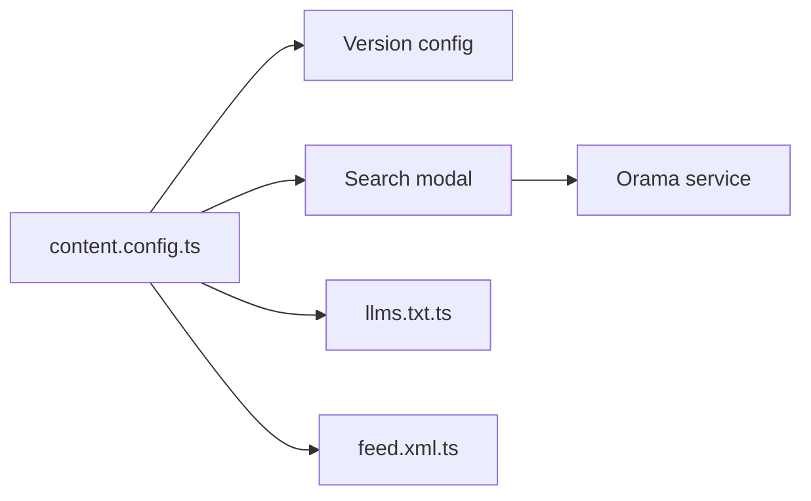

# expressjs/expressjs.com

> Official Express.js website and documentation, built with Astro, TypeScript and MDX.

## The problem
Express documentation must exist in several versions and languages.

## What it actually does
Minimal README. From the architecture: content collections, menus, version selector, Orama search, `llms.txt` exports and RSS feeds, vulnerability feeds, link rewriting for localization.

## How it is wired


## Trying it
```bash
npm install
npm run dev
```
Server on `http://localhost:4321`; Node >= 24.15.0 and npm >= 11.0.0.

## Cost and gotchas
Free. Very recent Node versions required.

## What it is not
Not the Express framework: only its website.

## Alternatives
No alternative cited in the README.

## For you
Ignore: only useful for contributing to the Express docs.
