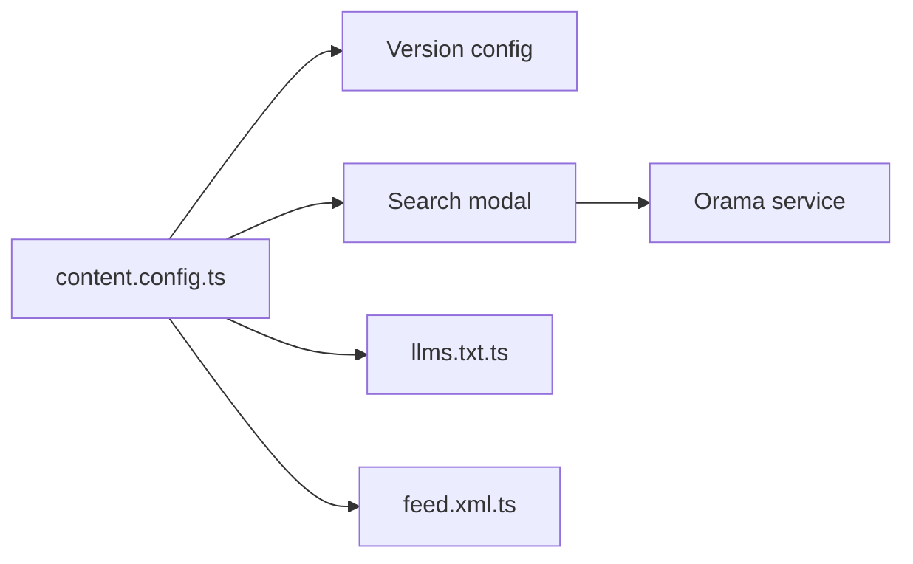

# expressjs/expressjs.com

> Site et documentation officiels d'Express.js, construits avec Astro, TypeScript et MDX.

## Le problème
La documentation d'Express doit exister en plusieurs versions et langues.

## Ce que ça fait vraiment
README minimal. D'après l'architecture : collections de contenu, menus, sélecteur de version, recherche Orama, exports `llms.txt` et flux RSS, flux de vulnérabilités, réécriture de liens pour la localisation.

## Comment c'est branché


## Essayer
```bash
npm install
npm run dev
```
Serveur sur `http://localhost:4321` ; Node >= 24.15.0 et npm >= 11.0.0.

## Coût et pièges
Gratuit. Versions de Node très récentes exigées.

## Ce que ce n'est pas
Pas le framework Express : seulement son site.

## Alternatives
Aucune alternative citée dans le README.

## Pour toi
À ignorer : utile uniquement pour contribuer à la doc d'Express.

