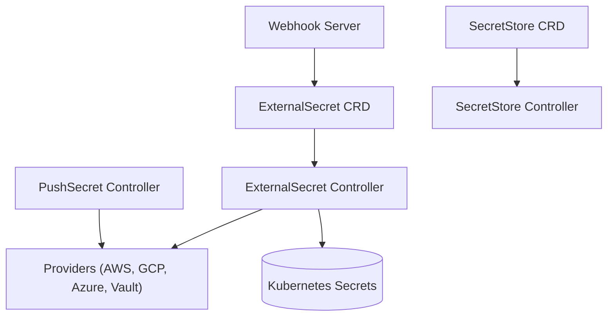

# external-secrets/external-secrets

> Kubernetes operator that syncs secrets from an external manager into native Kubernetes Secrets.

## The problem
Secrets live in AWS, Vault or GCP, but pods need Kubernetes Secrets, and copying them by hand is fragile.

## What it actually does
The operator reads provider APIs (AWS Secrets Manager, HashiCorp Vault, Google Secret Manager, Azure Key Vault, IBM, Akeyless, CyberArk, Pulumi ESC…) and injects the values into Kubernetes Secrets. Dedicated resources describe the source (SecretStore, ClusterSecretStore) and the target (ExternalSecret, ClusterExternalSecret). PushSecret does the reverse path, toward the provider.

## How it is wired

## Trying it
No command documented in the README: installation and guides are on external-secrets.io.

## Cost and gotchas
Free, but you need a Kubernetes cluster and an account with the chosen secrets manager, with its own costs. Secrets do end up in clear text in Kubernetes Secrets: protect them on the cluster side.

## What it is not
Not a vault: it stores nothing, it syncs. It does not encrypt Kubernetes Secrets for you.

## Alternatives
No alternative cited in the README.

## For you
Adopt if your ML deployments run on Kubernetes: it avoids pasting API keys into manifests, and the project is mature (created in 2018 on the team side, repository from 2020, SBOM published).
