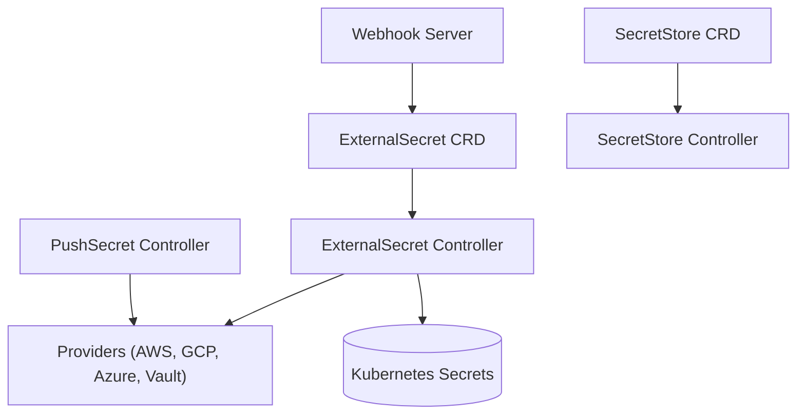

# external-secrets/external-secrets

> Opérateur Kubernetes qui synchronise les secrets d'un gestionnaire externe vers des Secrets Kubernetes natifs.

## Le problème
Les secrets vivent dans AWS, Vault ou GCP, mais les pods ont besoin de Secrets Kubernetes, et les copier à la main est fragile.

## Ce que ça fait vraiment
L'opérateur lit les API de fournisseurs (AWS Secrets Manager, HashiCorp Vault, Google Secret Manager, Azure Key Vault, IBM, Akeyless, CyberArk, Pulumi ESC…) et injecte les valeurs dans des Secrets Kubernetes. Des ressources dédiées décrivent la source (SecretStore, ClusterSecretStore) et la cible (ExternalSecret, ClusterExternalSecret). PushSecret fait le chemin inverse, vers le fournisseur.

## Comment c'est branché

## Essayer
Aucune commande documentée dans le README : l'installation et les guides sont sur external-secrets.io.

## Coût et pièges
Gratuit, mais il faut un cluster Kubernetes et un compte chez le gestionnaire de secrets choisi, avec ses propres coûts. Les secrets finissent bien en clair dans des Secrets Kubernetes : à protéger côté cluster.

## Ce que ce n'est pas
Pas un coffre-fort : il ne stocke rien, il synchronise. Il ne chiffre pas les Secrets Kubernetes à ta place.

## Alternatives
Aucune alternative citée dans le README.

## Pour toi
À adopter si tes déploiements ML tournent sur Kubernetes : il évite de coller des clés d'API dans les manifestes, et le projet est mûr (créé en 2018 côté équipe, dépôt de 2020, SBOM publié).

