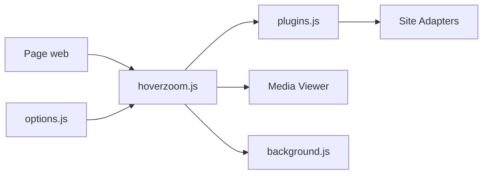

# extesy/hoverzoom

> Browser extension that enlarges images and videos on hover on supported sites.

## The problem
Seeing an image at full size on a site means opening it in a new tab.

## What it actually does
When you hover over a media item, the extension resolves the full-size URL through site-specific adapters (`plugins` folder), displays it in a window that fits within the page, plays video streams (hls.js) and offers saving or opening. Settings via options and popup. Open source version of a HoverZoom that was removed after a takeover by malware; the maintainer states that no data is collected.

## How it is wired

## Trying it
No command documented in the README (installation from the Chrome, Firefox and Edge stores).

## Cost and gotchas
Free. The adapters break when a site changes its design; 244 open issues.

## What it is not
Not a universal downloader. The privacy promises remain those of the README.

## Alternatives
No alternative named in the README.

## For you
Ignore: general-public browsing utility, unrelated to your work.
