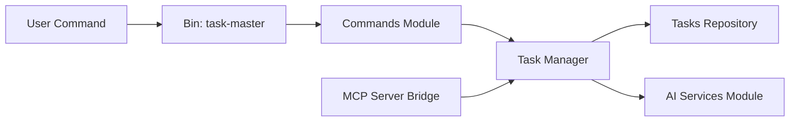

# eyaltoledano/claude-task-master

> LLM-driven task manager that breaks a PRD into tasks for coding agents.

## The problem
A coding agent loses the thread on a large project: without a broken-down plan and dependencies, it skips steps or redoes work.

## What it actually does
Parses a PRD (`.taskmaster/docs/prd.txt`) into tasks with dependencies, subtasks and tags.
Commands: `parse-prd`, `list`, `next`, `expand`, `research`, `move`; usable as a CLI or through an MCP server (36 tools).
Three configurable models (main, research, fallback) from Anthropic, OpenAI, Perplexity, etc., or via Claude Code/Codex without a key.
Selective loading of MCP tools (`TASK_MASTER_TOOLS`) to limit context (~21k tokens in `all` mode).

## How it is wired


## Trying it
```bash
npm install -g task-master-ai
task-master init
task-master parse-prd your-prd.txt
task-master next
claude mcp add taskmaster-ai -- npx -y task-master-ai
```

## Cost and gotchas
At least one API key required (except Claude Code/Codex). The `all` mode consumes ~21k tokens of context.

## What it is not
MIT license + Commons Clause: forbidden to resell it or offer it as a hosted service. Not a team project management tool (commercial link to Hamster).

## Alternatives
No alternative named in the README.

## For you
Keep an eye on it: useful to keep an agent on track in a long project, but the commercial clause and the context consumption limit its appeal compared with Claude Code's native plan mode.
