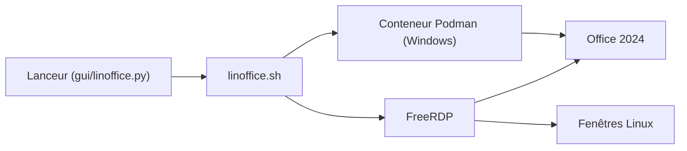

# eylenburg/linoffice

> Launcher that runs Microsoft Office on Linux through a Windows virtual machine accessed via FreeRDP.

## The problem
Microsoft Office does not exist on Linux, and Wine-based solutions handle recent versions poorly.

## What it actually does
LinOffice installs Windows and Office 2024 in a Podman container (Dockur/Windows, QEMU), then displays the applications as native windows through FreeRDP. It suspends the VM when idle, deletes `~$` lock files and exposes the home folder and the clipboard. A fork of WinApps, it automates the setup.

## How it is wired
Simplified diagram based on the sheet, no diagram provided.


## Trying it
```bash
flatpak remote-add --if-not-exists --user linoffice https://eylenburg.github.io/linoffice/index.flatpakrepo && flatpak install --user linoffice io.github.eylenburg.LinOffice
cd "$HOME/.local/bin/linoffice" && python3 gui/linoffice.py
./linoffice.sh word
```

## Cost and gotchas
You need your own Office license, 8 GB of RAM minimum at setup (VM up to 4 GB), 64 GB of disk, KVM and about 8 GB to download. FreeRDP 3.23 is incompatible. The VM credentials are hardcoded (`MyWindowsUser` / `MyWindowsPassword`).

## What it is not
It is not native Office nor a Wine layer: it is a real Windows in a VM. Window management remains finicky, especially under Wayland or on multiple monitors, and printing goes through the VM.

## Alternatives
WinApps or Winboat for other Windows applications; Wine options (Crossover, PlayOnLinux, Bottles) for a lighter solution.

## For you
Ignore: an office productivity tool unrelated to data or MLOps, and resource-hungry with a paid Office license.
