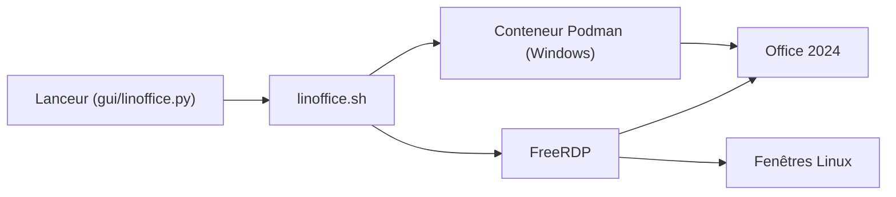

# eylenburg/linoffice

> Lanceur qui fait tourner Microsoft Office sous Linux via une machine virtuelle Windows accessible en FreeRDP.

## Le problème
Microsoft Office n'existe pas sous Linux, et les solutions Wine gèrent mal les versions récentes.

## Ce que ça fait vraiment
LinOffice installe Windows et Office 2024 dans un conteneur Podman (Dockur/Windows, QEMU), puis affiche les applications comme des fenêtres natives via FreeRDP. Il suspend la VM à l'inactivité, supprime les fichiers de verrou `~$` et expose le dossier personnel et le presse-papiers. Fork de WinApps, il automatise la configuration.

## Comment c'est branché
Schéma simplifié d'après la fiche, sans diagramme fourni.


## Essayer
```bash
flatpak remote-add --if-not-exists --user linoffice https://eylenburg.github.io/linoffice/index.flatpakrepo && flatpak install --user linoffice io.github.eylenburg.LinOffice
cd "$HOME/.local/bin/linoffice" && python3 gui/linoffice.py
./linoffice.sh word
```

## Coût et pièges
Il faut ta propre licence Office, 8 Go de RAM minimum au setup (VM jusqu'à 4 Go), 64 Go de disque, KVM et environ 8 Go à télécharger. FreeRDP 3.23 est incompatible. Les identifiants de la VM sont codés en dur (`MyWindowsUser` / `MyWindowsPassword`).

## Ce que ce n'est pas
Ce n'est pas Office natif ni une couche Wine : c'est un vrai Windows en VM. La gestion des fenêtres reste capricieuse, surtout sous Wayland ou en multi-écrans, et l'impression passe par la VM.

## Alternatives
WinApps ou Winboat pour d'autres applications Windows ; les options Wine (Crossover, PlayOnLinux, Bottles) pour une solution moins lourde.

## Pour toi
À ignorer : outil de bureautique sans rapport avec la data ou le MLOps, et coûteux en ressources avec une licence Office payante.

