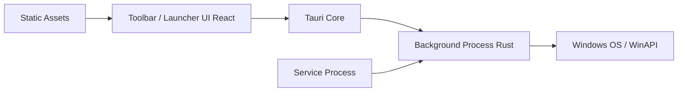

# eythaann/Seelen-UI

> Fully customizable Windows desktop environment: bar, dock, tiling manager, widgets.

## The problem
Windows' interface offers little customization: taskbar, Start menu, virtual desktops and alt-tab are fixed.

## What it actually does
Replaces the taskbar (toolbar, dock), adds a tiling window manager, a fuzzy-search launcher, desktop widgets, virtual desktops and a CSS/JSON theme with an accent color drawn from the wallpaper. Tauri application: React/TypeScript interfaces, Rust "background" and "service" processes. Widget SDK (Svelte/TypeScript). 70+ languages.

## How it is wired


## Trying it
```pwsh
winget install --id Seelen.SeelenUI
```
Or the Microsoft Store, or the `.msix`/`.exe` installers from the Releases.

## Cost and gotchas
Free (AGPL-3.0). Requires WebView2 and Edge; on Windows 10, WebView2 is provided by `setup.exe`. A white screen is possible on a fresh install before Windows is updated.

## What it is not
Not a simple theme: a shell replacement, with the risk that implies.

## Alternatives
No alternative named in the README (the launcher is "inspired by Rofi").

## For you
Windows desktop comfort, unrelated to data/AI work: ignore.
