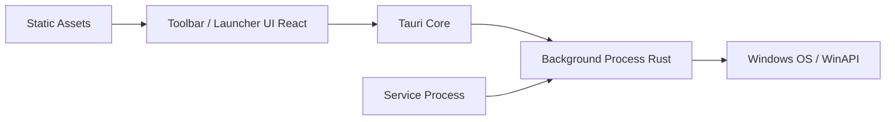

# eythaann/Seelen-UI

> Environnement de bureau Windows entièrement personnalisable : barre, dock, gestionnaire en tuiles, widgets.

## Le problème
L'interface de Windows se personnalise peu : barre des tâches, menu Démarrer, bureaux virtuels et alt-tab sont figés.

## Ce que ça fait vraiment
Remplace la barre des tâches (toolbar, dock), ajoute un gestionnaire de fenêtres en tuiles, un lanceur à recherche floue, des widgets de bureau, des bureaux virtuels et un thème CSS/JSON avec couleur d'accent tirée du fond d'écran. Application Tauri : interfaces React/TypeScript, processus Rust « background » et « service ». SDK de widgets (Svelte/TypeScript). 70+ langues.

## Comment c'est branché


## Essayer
```pwsh
winget install --id Seelen.SeelenUI
```
Ou Microsoft Store, ou installeurs `.msix`/`.exe` des Releases.

## Coût et pièges
Gratuit (AGPL-3.0). Requiert WebView2 et Edge ; sur Windows 10, WebView2 est fourni par `setup.exe`. Écran blanc possible sur installation neuve avant mise à jour de Windows.

## Ce que ce n'est pas
Pas un simple thème : un remplacement du shell, avec le risque que cela suppose.

## Alternatives
Aucune alternative nommée dans le README (le lanceur est « inspiré de Rofi »).

## Pour toi
Confort de bureau Windows, étranger au travail data/IA : à ignorer.

