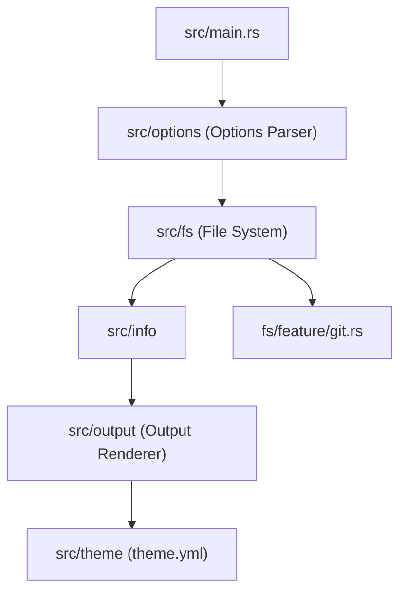

# eza-community/eza

> Modern replacement for the `ls` command, in a single binary, with colors, icons and Git status.

## The problem
`ls` displays little useful information: no link with Git, few colors, hard-to-read options.

## What it actually does
Lists files with colors by type, icons, long view, recursive tree, Git status per file or repository, SELinux contexts, mount details, relative dates and hyperlinks. Customizable themes through a `theme.yml` file. Successor of the exa project.

## How it is wired


## Trying it
```bash
nix run github:eza-community/eza
nix run github:eza-community/eza -- -ol
```
For other systems, the README points to INSTALL.md.

## Cost and gotchas
Free. EUPL-1.2 license, copyleft: check if you redistribute a modified version. Icons need a suitable font in the terminal (not specified by the README). Last push in August 2026.

## What it is not
Not a strictly compatible replacement: the README says its options are "almost, but not quite" those of `ls`. Not a file manager.

## Alternatives
- exa: the original project, whose flaws eza fixes ("Grid Bug" among others).

## For you
Adopt: a more readable `ls` with Git status, useful for browsing data project repositories, at no adoption cost.
