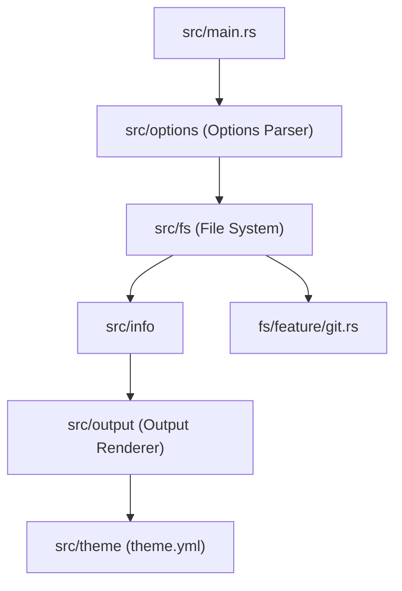

# eza-community/eza

> Remplaçant moderne de la commande `ls`, en un seul binaire, avec couleurs, icônes et état Git.

## Le problème
`ls` affiche peu d'informations utiles : pas de lien avec Git, peu de couleurs, des options peu lisibles.

## Ce que ça fait vraiment
Liste les fichiers avec couleurs par type, icônes, vue longue, arbre récursif, état Git par fichier ou dépôt, contextes SELinux, détails de montage, dates relatives et liens hypertextes. Thèmes personnalisables via un fichier `theme.yml`. Héritier du projet exa.

## Comment c'est branché


## Essayer
```bash
nix run github:eza-community/eza
nix run github:eza-community/eza -- -ol
```
Pour les autres systèmes, le README renvoie à INSTALL.md.

## Coût et pièges
Gratuit. Licence EUPL-1.2, copyleft : à vérifier si tu redistribues une version modifiée. Les icônes demandent une police adaptée dans le terminal (non précisé par le README). Dernier push en août 2026.

## Ce que ce n'est pas
Pas un remplacement strictement compatible : le README dit que ses options sont « presque, mais pas tout à fait » celles de `ls`. Pas un gestionnaire de fichiers.

## Alternatives
- exa : le projet d'origine, dont eza corrige des défauts (« Grid Bug » entre autres).

## Pour toi
À adopter : un `ls` plus lisible avec état Git, utile pour parcourir des dépôts de projets data, sans coût d'adoption.

