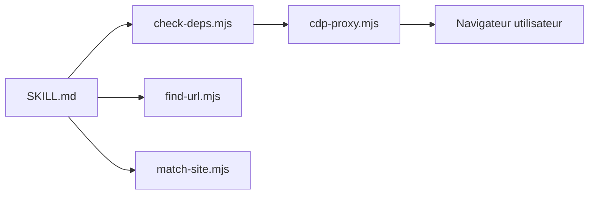

# eze-is/web-access

> Skill for AI agents that adds a web browsing strategy and control of the user's browser via CDP.

## The problem
WebSearch and WebFetch alone lack strategy and cannot handle dynamic pages or logged-in sessions.

## What it actually does
Chooses between WebSearch, WebFetch, curl, Jina and CDP. A local CDP proxy (port 3456) drives Chrome or Edge with their sessions: open a tab, evaluate JS, click, upload, capture, scroll. Finds pages in bookmarks and history (`find-url.mjs`), remembers per-site quirks, delegates in parallel to sub-agents.

## How it is wired


## Trying it
```bash
npx skills add eze-is/web-access
claude plugin marketplace add https://github.com/eze-is/web-access
node "${CLAUDE_SKILL_DIR}/scripts/check-deps.mjs"
```

## Cost and gotchas
Node 22+ and remote debugging enabled in the browser. The proxy has access to your logged-in browser. The README advises against using your main social media account (risk of being blocked). No license declared: usage rights are uncertain.

## What it is not
Not an autonomous scraper: a guide for the agent plus a proxy. Repository created in March 2026.

## Alternatives
No alternative named in the README.

## For you
Worth watching: useful for automating research with your sessions, but with no license and broad access to your browser; isolate a dedicated profile.
